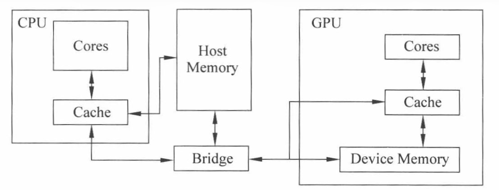
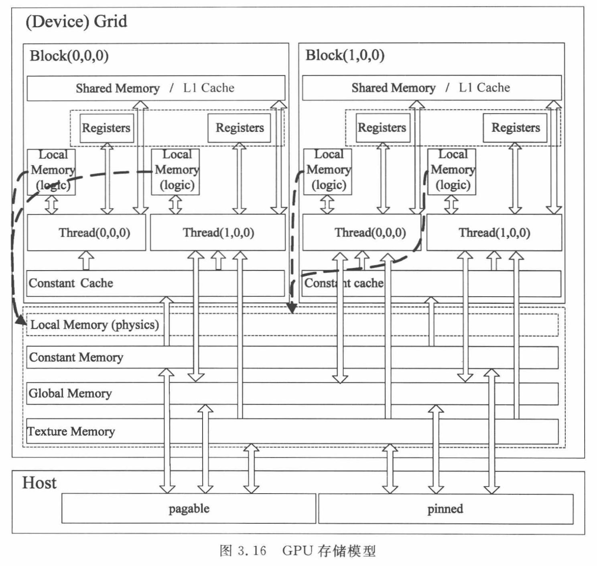
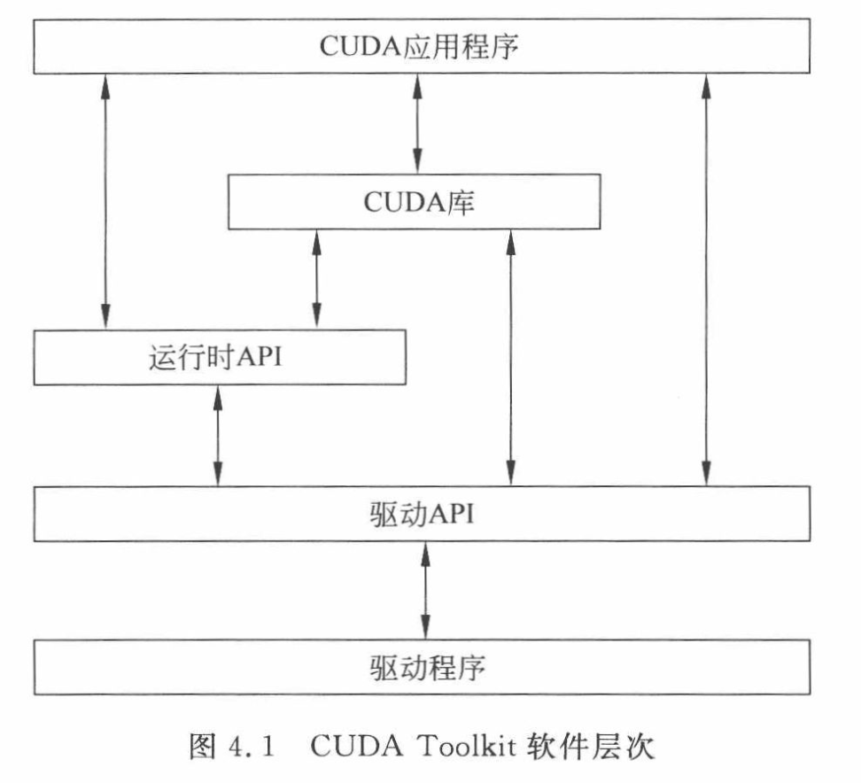
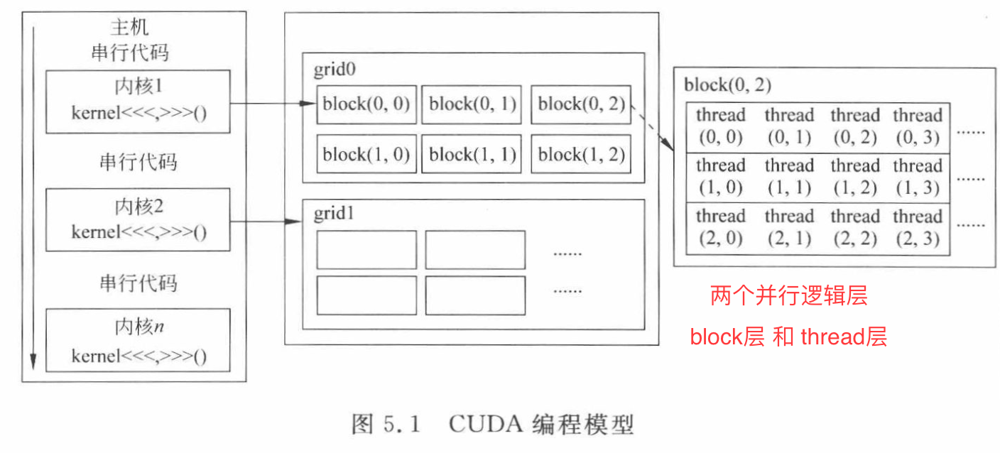
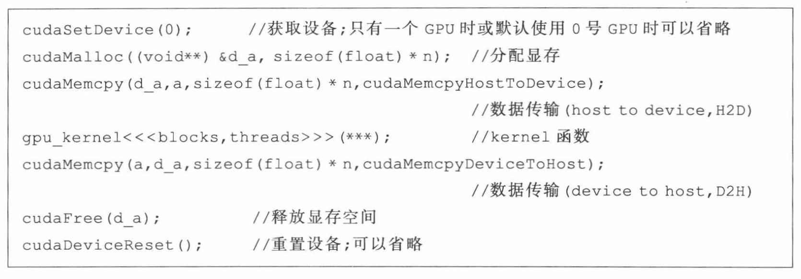
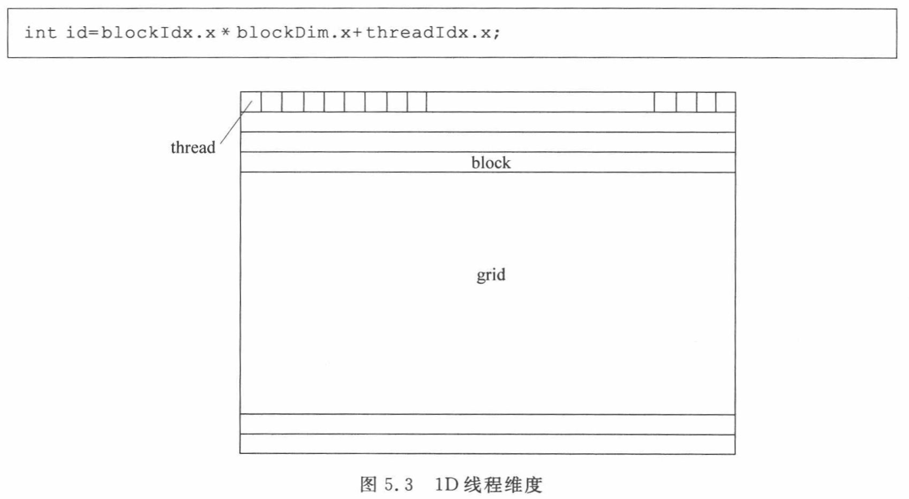
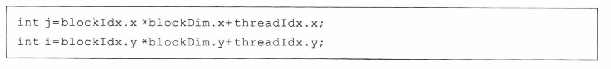
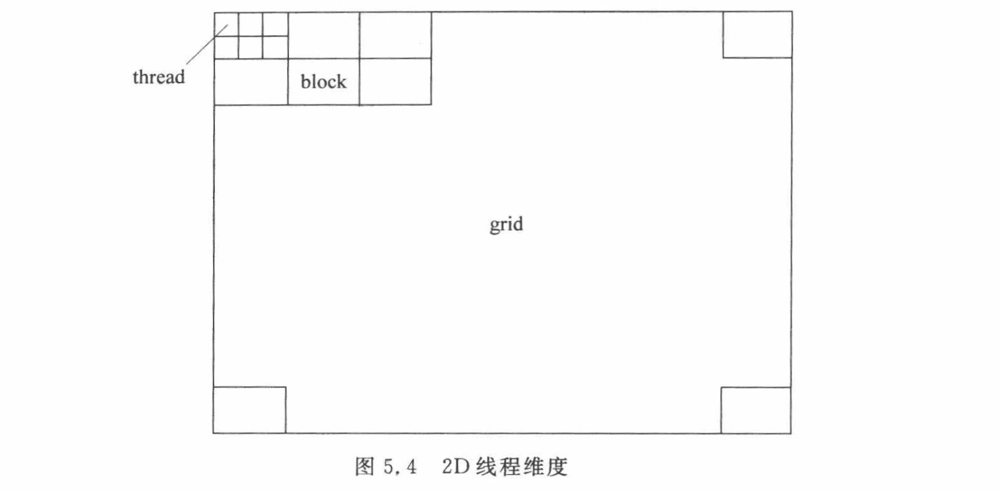
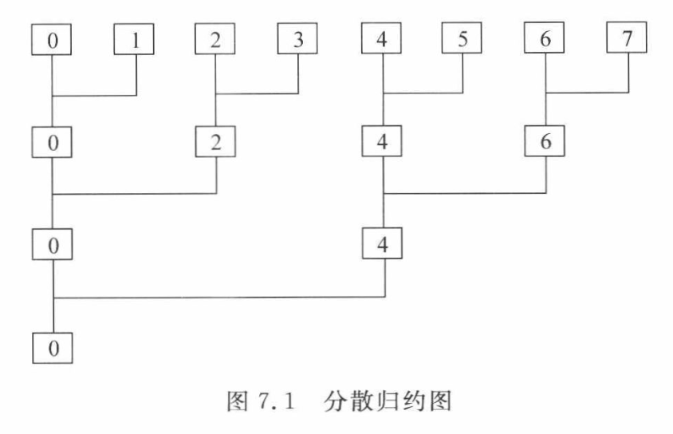
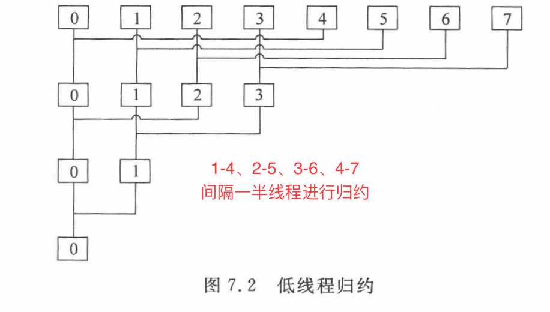

## 1 高性能概述
- 向量机：通过向量处理获得较高性能
- 阵列机：通过大量线程同时执行获得高吞吐

## 2 GPU概述
- CPU-GPU 通过北桥进行数据交互

## 3 GPU硬件架构

## 4 GPU软件体系

## 5 CUDA C 编程
- 主机端：有且仅有一个，一般为CPU
- 设备端：可以有多个，一般为GPU

- Block 映射到 SM，Thread 映射到 SP(core)

- CUDA编程模型七部曲，单GPU可简化为五部曲

- CUDA驱动 API（driver API）：基于句柄的底层接口，可加载二进制/汇编的kernel函数
- CUDA运行时 API（runtime API）：在驱动API上做了一层封装

- 函数修饰符：
	- device：只能被GPU端函数调用（即 device/global），无法被CPU端调用的函数
	- global：kernel函数，只能被CPU端调用，并且执行在 GPU 上
	- host：在主机上执行的函数，只能被CPU端调用
- 变量修饰符：
	- device：在GPU 上的变量，位于global memory 中
	- constant：在GPU 上的常量
	- shared：GPU 上的共享变量，仅供 black 内的 thread 共享使用
- 内置数组变量：
	- dim3：整型数组，用于描述指定线程块的维度
	- gridDim：指定 grid 维度
	- blockDim：指定 block 维度
	- blockIdx：指定 grid 内 block 索引号
	- threadIdx：指定 block 内 thread 索引号
	- warpsize：指定 warp 内 thread 数量

- 1D线程维度：grid 是一个二维矩阵，每一个block 是一行，每个thread 是行内元素

- 2D线程维度：grid是一个大矩形，由许多小矩形组成（block），小矩形内的元素是thread

## 6 向量加法
- `<<<blocknum, threadnum>>>`：调用kernel函数时配置的维度
	- block 维度
	- thread 维度
	- 共享存储大小
	- CUDA流索引号

## 7 归约：向量内积

### 单Block向量内积

 - 分散归约
	 - 违反存储对齐规则
	 - 共享存储访问可能会引发 bank conflict
	 - warp内thread执行同一条指令，故需要多个warp，带来性能损失

- 低线程归约
	- 分散归约会让活跃线程越来越稀疏，而低线程归约则让低线程一直处于活跃
	- 做 最终归约 有精度损失，做 中间归约 则无精度损失
	- 最小化执行 warp 数量
	- 数据对齐访问
	- 避免bank conflict

### 多Blcok向量内积：每个Block负责一个中间结果，再进行二次归约得结果
- CPU实现：由CPU完成二次归约，性能优于 GPU实现
- GPU实现：由GPU完成，通信数据量大幅减少，且通信带宽更高

- 基于原子操作：即使用原子计算完成内积运算
	- 避免访存冲突
	- 结果直接写回存储，故拿新值得 重新访存
	- 会产生精度损失

- 低线程用于最终结果计算时有精度损失，中间运算则无精度损失
- 原子操作计算不稳定，有精度损失
- volatile 关键字可以让 全局/共享存储中的变量 变为 敏感变量，每次要读取新值

## 8 矩阵乘法
- 一般矩阵乘法中，存储往往行优先，导致 B矩阵 的访问是不连续的
	- 循环交换矩阵乘法：每次取A的一个元素和B的一行做乘法，得到C的一行部分值，通过不断 移动A的值，对C对应位置进行累加，最终得到C的全部值
	- 转置矩阵乘法：对矩阵B进行转置，从而变成 行 x 行，具有很好的数据局部性，但是转置时依旧无法向量化，转置开销较大，实验发现其性能最好

- Grid 线程循环矩阵乘法，将一般矩阵乘的外层两个循环 合并 为一个，Grid 中每一个thread 负责运算 C矩阵的一个元素
	- Block 内线程对 A矩阵的访存不一致，带来额外的访存开销

- Block 线程循环矩阵乘法，每个 Block 运算 C矩阵的一行，Block内 Thread以固定步长访问 C矩阵，C有 N行，则使用 N个 Block运算

- 行共享存储矩阵乘法，在Block线程循环矩阵乘法中，Block内所有Thread都会使用A矩阵的一行，将该行放进 Shared Mem中加速访问
	- 若A矩阵一行过大，会OOM
	- B矩阵依然在全局存储中

- 分块矩阵乘法，每个Block运算C矩阵的一个小块，将所需的A/B矩阵数据随着计算逐步放入Shared Mem，更好的复用Shared Mem
	- 对于共享存储，应少量多次 + 尽可能多的数据复用，盲目使用有可能降低性能

## 9 矩阵转置
- 读连续矩阵转置：A矩阵读取 连续，C矩阵写入 不连续
- 写连续矩阵转置：A矩阵读取 不连续，C矩阵写入连续

- 1D 矩阵转置：一个block转置 矩阵一行/一列
- 2D矩阵转置：一个block 转置 矩阵的一小块
	- 可以将小块读到共享存储中进行转置，再返回结果矩阵 进行加速

## 10 卷积
- 一维卷积，行 x 列 --> 累加为一个值
	- 判断法，判断当前索引是否越界
	- 扩展法，扩展边界为0，类似于 哨兵，扩展宽度为 向量长度的一半
	- 可以将 一个数组 用Shared/Constant存储，从而加速其计算，常量存储效果更好一些
- 二维卷积，矩阵 x 矩阵 --> 累加为一个值
	- 判断法，带来了很多额外的分支开销，性能较差
	- 扩展法，扩展宽度为 矩阵边长的一半

## 15 GPU 执行核心
- 以 Block 为单位 映射到 SM，以 Warp 为单位执行
	- 若warp 内有分支指令，则需要串行执行，线程无法并行执行
	- warp原语，作用范围仅为warp的特殊指令
		- 投票：评估条件并广播 一位结果 给每个Thread
		- 洗牌：warp内 thread不经过共享存储进行数据交换
	- block 原语，多为block内thread同步原语

- Kernel开销
	- kernel 函数内循环开销：GPU内部循环产生的开销，开销一般
	- kernel 函数执行线程调度开销：GPU上线程切换开销，开销最小
	- kernel 函数循环启动开销：CPU把kernel调度到GPU的开销，开销最大

## 16 GPU存储体系
- 寄存器，速度最快的存储单元
	- 一个线程的最大寄存器数量是256个
	- 寄存器使用量是影响占有率的重要因素
- 局部存储，从显存虚拟出来的地址空间
	- 存放单线程的大型数组、过多的变量
	- 线程私有，线程间不可见
	- 物理上是从 显存中 划分出来的
	- kernel 中的私有函数 尽量声明在 寄存器中
- 共享存储器
	- 访存延迟仅次于 寄存器
	- 可被一个block内所有thread 共享
	- 静态共享存储：利用 shared 限定符 指定具体尺寸，可多次声明
	- 动态共享存储：用 extern 修饰词 修饰 shared 限定符，仅能声明一次
	- 由 交替排列的 bank 组成，数量往往与warp内线程数量一致，需注意bank冲突
	- volatile 关键字将全局/共享存储中的变量 设置为 敏感变量（每次使用新读取）
	- 在原子操作中，单个线程串行，其他线程循环等待
- 常量存储，类似于 局部存储
	- 当warp内所有线程 同时 访问同一个常量时启动
- 全局存储
	- kernel函数通过 全局存储 读写 显存
	- 通过 cudaMalloc( ) 、cudaFree( ) 动态分配 和 释放
	- 通过 内存控制器访问，可以通过合并访问，来充分发挥 控制器的性能
- 主机端内存
	- 可分页内存：malloc/free，可能被换到硬盘
	- 页锁定内存：cudaHostAlloc/cudaFreeHost，一直在内存空间
	- 零拷贝操作：kernel 函数直接访问主机端的页锁定存储

## 17 GPU关键性能指标
- 常见指标
	- 浮点计算能力
	- 访存带宽
	- 通信带宽
- 精确测试方法
	- clock( ) 函数，秒级的测时，时间低于1秒则误差非常大
	- gettimeofday( )函数，毫秒级的测时，最常用的测时方法
	- CUDA事件测时，毫秒级，必须有CUDA环境

## 18 CPUs-GPUs
- 注意 编译器 往往不兼容，需要独立封装编译
